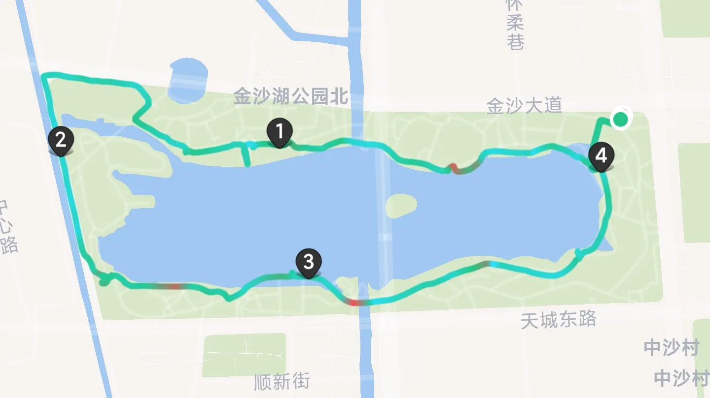
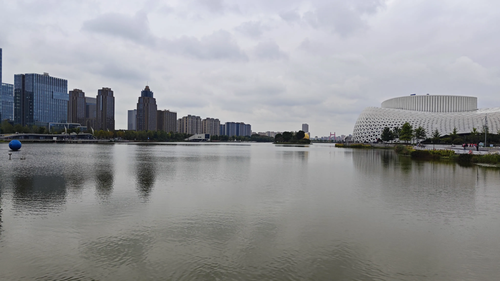
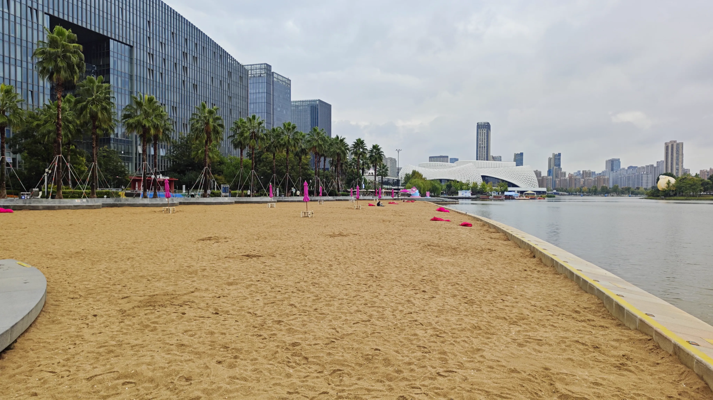
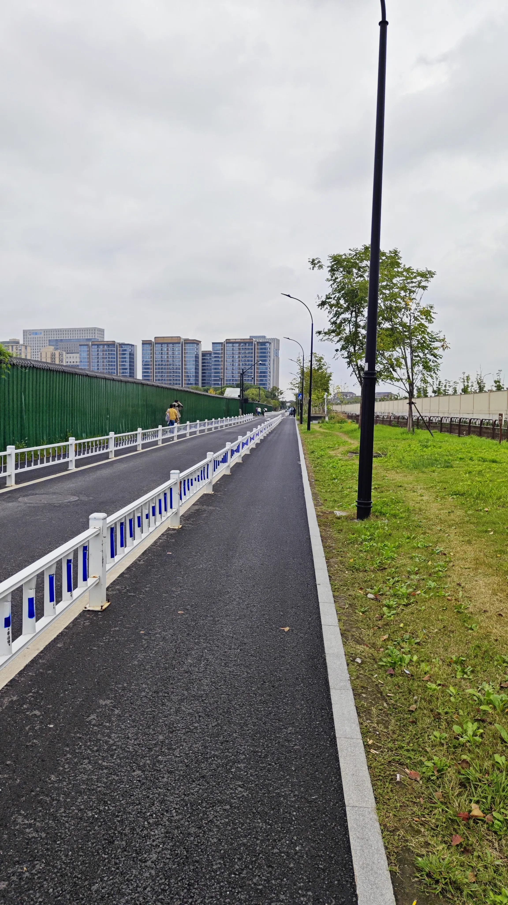
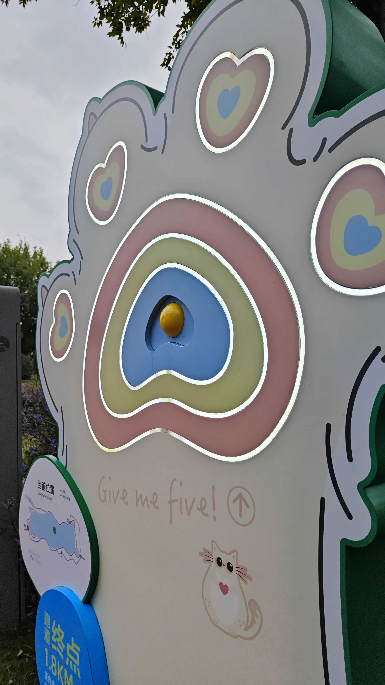
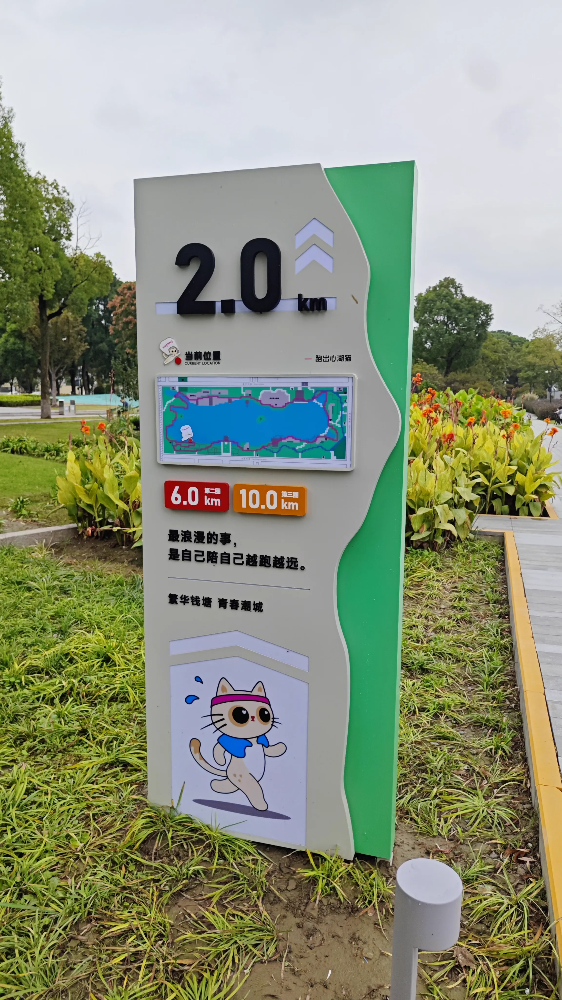
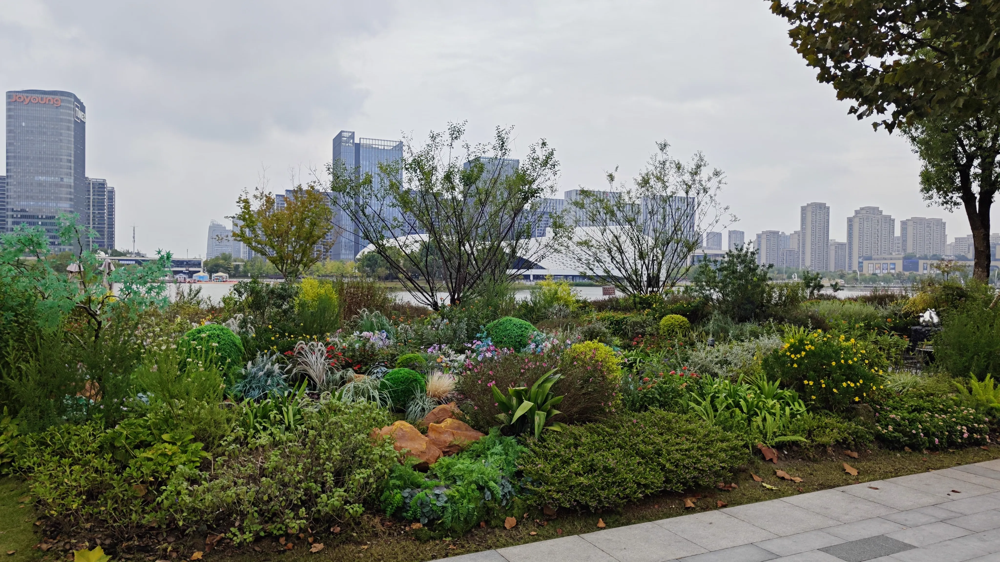
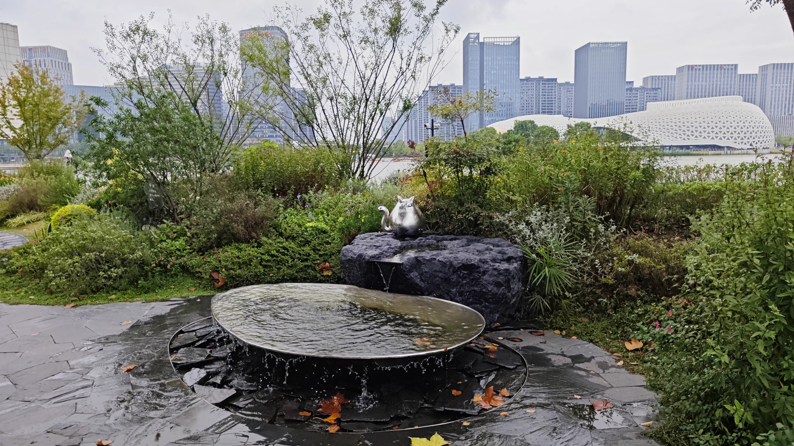
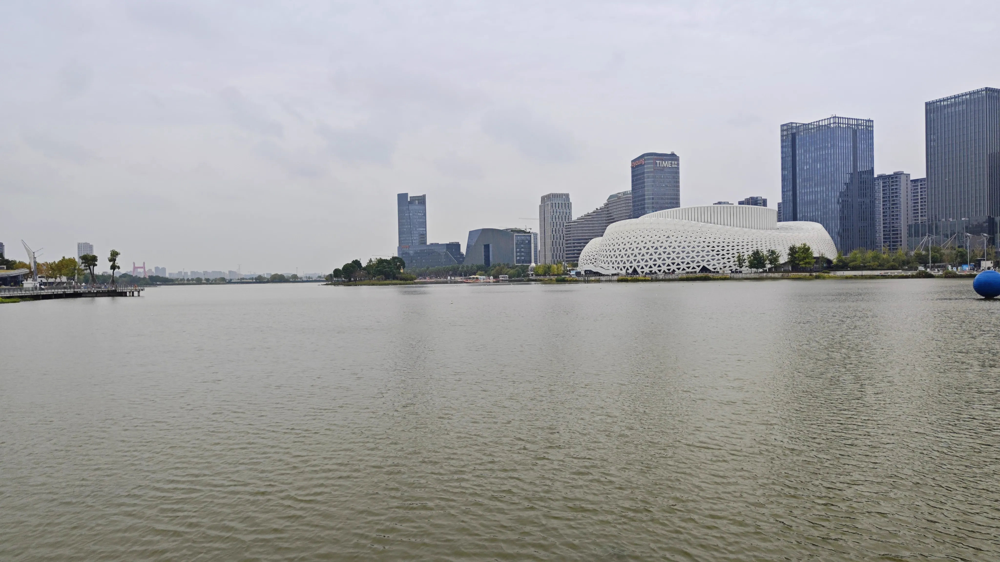

金沙湖公园距杭电仅两站地铁，在金沙湖地铁站 C 口出站即可到达。

<figure>
    
    <figcaption>环金沙湖路线截图</figcaption>
</figure>

公园开发较完善，除西侧正在维修以外，北侧、东侧、南侧均有完善的步道和绿地。金沙湖站 C 口位于东北角，下沙西站位于西北角。

<figure>
    
    <figcaption>公园东北角</figcaption>
</figure>

沿湖向东走即可到达金沙湖大剧院，此处有一公共厕所。继续向东走可经过一片沙滩。大概是时间段和天气的共同因素，游玩的人并不多。沙滩边有带摄像头的电子屏幕，可供游客交互游玩。

<figure>
    
    <figcaption>从沙滩回望金沙湖大剧院</figcaption>
</figure>

公园西侧有一块正在维修的空地，路窄车多，行人与非机动车混杂，需格外小心。

<figure>
    
    <figcaption>西侧窄路</figcaption>
</figure>

公园西南角为金沙湖的入水口，也是公园南侧铺设跑道的终点。

    <figure>
        
        <figcaption>可交互的终点按钮</figcaption>
    </figure>
    <figure>
        
        <figcaption>跑道里程标牌</figcaption>
    </figure>

公园南侧有较大的亲水观景台，可以饱览湖上风光。湖边有若干饭店、小型赛车场，以及所谓“低空科技馆”。经过时，有一架送货无人机正从此处升空，向西北方飞去。

<figure>
    

        
        
    

    <figcaption>名为“莫奈花园”的绿植造景</figcaption>
</figure>

继续沿着湖边步道前行，可从东面回到金沙湖地铁站 C 口。

<figure>
    
    <figcaption>东南角湖景</figcaption>
</figure>

周边餐饮较多，有“龙湖金沙天街”等商业体。亦可选择回校用餐，仅需 15 分钟路程。
